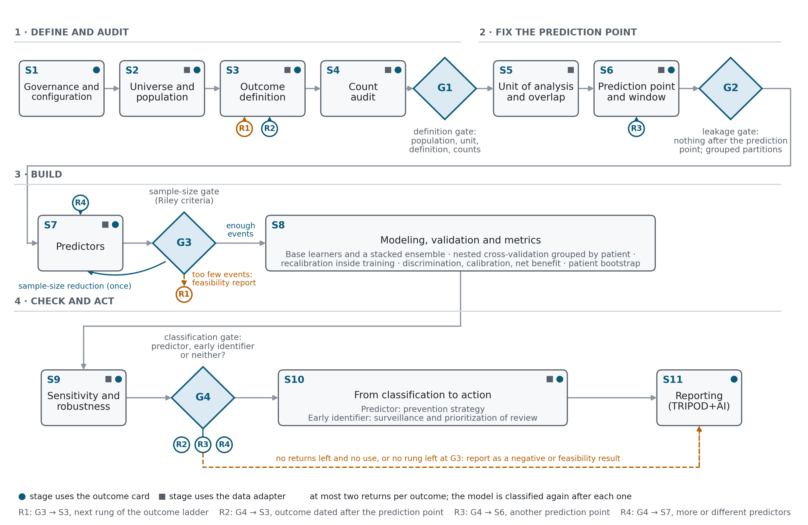

# Framework por etapas para modelos de predicción clínica — versión 1.0

Versión 1.0, 17/11/2026. Reemplaza la maqueta del 29/10/2026 (versión 0.1, guardada en [`docs/backup_framework_v0.1/`](docs/backup_framework_v0.1/)). Esta versión es el framework tal como se aplicó y se publicó en el estudio de morbilidad materna grave (SMM) (`MaternalMortality_MIMIC-IV_Cureus`, artículo enviado a Cureus en noviembre de 2026), con las reglas que se agregaron durante esa aplicación. Este proyecto, muerte perinatal antes del nacimiento, es su segunda aplicación. Versión en inglés: [`framework.md`](framework.md).

> **Nomenclatura.** Los archivos en español usan las etapas E1 a E11 y las puertas P1 a P4. Los archivos en inglés usan S1 a S11 y G1 a G4 para las mismas etapas y puertas, como en el artículo de SMM. Los análisis de sensibilidad del plan de este proyecto se renombraron SA1 a SA11 para que no choquen con las etapas en inglés. La versión 0.1 numeraba las etapas E0 a E11; la equivalencia está en la sección 9.

*Figura. Figura 1 del artículo de SMM (en inglés: S = etapa, G = puerta). Un punto marca las etapas que usan la ficha del desenlace y un cuadrado las que usan el adaptador de datos; las etapas sin marca se reutilizan sin cambios.*

## 1. Qué responde el framework

Un modelo con buena discriminación puede predecir eventos que aún no ocurren o solo reconocer eventos que ya están en curso cuando se hace la predicción. El framework lleva cualquier desenlace adverso desde la definición hasta el reporte y termina clasificando el modelo ajustado como **predictor**, **identificador temprano** o **ninguno**. El estudio de SMM mostró por qué: un modelo con AUROC de 0,79 falló tres de los cuatro criterios y resultó un identificador temprano.

## 2. Tres capas

| Capa | Contiene | Cambia cuando |
|---|---|---|
| **Núcleo** | Etapas, puertas, validación, métricas, regla de clasificación, reporte | Nunca entre desenlaces |
| **Ficha del desenlace** | Peldaño en la escalera de desenlaces, población, definición y momento del evento, punto de predicción, predictores propios, conjunto reducido de predictores, modelo principal, set de sensibilidad, conteos esperados | Un desenlace nuevo necesita una ficha nueva |
| **Adaptador de datos** | Código que convierte una fuente de datos en la tabla contrato | Una fuente nueva necesita un adaptador nuevo |

El núcleo solo lee la **tabla contrato**: una fila por unidad de análisis con `unit_id`, `group_id` (nunca se divide entre entrenamiento y prueba), `t0` (tiempo cero), `t_pred` (punto de predicción), la etiqueta principal y las de sensibilidad como columnas, cada predictor con un indicador de si se midió, y `period` (período calendario o era de codificación). Para MIMIC-IV el adaptador es `sql/00_mimic_layer/01_unit_of_analysis.sql` (tarea T17) más las tablas de etiqueta y de predictores.

## 3. Etapas y puertas

| Bloque | Etapa o puerta | Pregunta | Ficha | Adaptador |
|---|---|---|---|---|
| Definir y auditar | **E1** Gobierno y configuración | ¿Qué se fija antes de correr nada? | • | |
| | **E2** Universo y población | ¿Qué unidades se pueden estudiar? | • | ■ |
| | **E3** Definición del desenlace | ¿Qué cuenta como evento, de qué fuentes y cuándo ocurrió? | • | ■ |
| | **E4** Auditoría de conteos | ¿Cuántos eventos, dónde, cuándo y con qué solapamiento? | • | ■ |
| | **P1** Puerta de definición | ¿Están fijos la población, la unidad y la definición, y se reproducen los conteos de referencia? | | |
| Fijar el punto de predicción | **E5** Unidad de análisis y solapamiento | ¿Qué es un registro y qué debe quedar en un solo lado de una partición? | | ■ |
| | **E6** Punto de predicción y ventana | ¿Cuándo se predice y qué información puede usarse? | • | ■ |
| | **P2** Puerta de fuga | ¿No entra nada posterior al punto de predicción y las particiones están agrupadas por paciente? | | |
| Construir | **E7** Predictores | ¿Qué variables, con qué cobertura y límites? | • | ■ |
| | **P3** Puerta de tamaño de muestra | ¿Hay eventos suficientes para los parámetros candidatos (Riley et al.)? | | |
| | **E8** Modelado, validación y métricas | ¿Qué tan bien funciona y con qué incertidumbre? | | |
| Verificar y actuar | **E9** Sensibilidad y robustez | ¿Resiste otras decisiones razonables, incluidos los criterios C1 a C4? | • | ■ |
| | **P4** Puerta de clasificación | ¿Predictor, identificador temprano o ninguno? | | |
| | **E10** De la clasificación a la acción | ¿Qué uso corresponde a la clase y es justo entre subgrupos? | • | ■ |
| | **E11** Reporte (TRIPOD+AI) | ¿Qué se entrega? | • | |

No se ajusta ningún modelo antes de P3. Cada decisión va al **libro de decisiones** con su fecha, las opciones consideradas, la opción elegida, la razón, el tipo de razón (clínica, metodológica o técnica) y quién la validó.

## 4. Las puertas en detalle

**P1, definición.** La población, la unidad y la definición del evento están fijas y los conteos de referencia se reproducen (una verificación `EXPECTED` detiene cualquier corrida cuya población no sea la auditada).

**P2, fuga.** No entra información posterior al punto de predicción (ni diagnósticos, procedimientos, códigos DRG o tratamientos de la misma admisión) y toda partición está agrupada por paciente. La imputación, el escalado, el ajuste, el apilamiento y la recalibración se ajustan dentro de la parte de entrenamiento.

**P3, tamaño de muestra.** Los criterios de Riley et al. (encogimiento esperado de 0,9 o más, optimismo en la variación explicada de 0,05 o menos, riesgo global preciso) dan el mínimo de unidades y eventos para los parámetros candidatos, con el R² de Cox-Snell observado de una regresión logística con validación cruzada (o un valor supuesto cuando no se puede ajustar ningún modelo). Si los datos no alcanzan, el desenlace se reporta como análisis de factibilidad y el retorno R1 pasa al siguiente peldaño de la escalera de desenlaces.

**Reducción por tamaño de muestra (regla agregada el 09/11/2026).** Cuando un modelo cumple todos los criterios aplicables de P4 pero no pasa P3, puede reajustarse **una vez** con un conjunto reducido de predictores que no supere los parámetros que soportan los datos. El conjunto reducido se fija en la ficha con reglas (colapsar categorías, conservar las variables clínicas centrales), nunca por la asociación de un predictor con el desenlace. El modelo reducido debe pasar P3 y se clasifica de nuevo en P4 con los mismos umbrales. No es un retorno.

**P4, clasificación.** Cuatro criterios, cada uno probado con un análisis de sensibilidad preespecificado:

| Criterio | Pregunta | Se cumple si |
|---|---|---|
| C1, eventos ya presentes | ¿Cuánto cae el desempeño al retirar los eventos presentes en el punto de predicción (población landmark)? | La AUROC cae 0,05 o menos y se conservan al menos dos tercios de la ganancia de AUPRC sobre la prevalencia |
| C2, desenlace con tiempo | ¿Se mantiene el desempeño para eventos fechados después del punto de predicción? | AUROC de 0,75 o más, con límite inferior del IC 95% de 0,70 o más |
| C3, sesgo de detección | ¿Se mantiene entre las pacientes examinadas, cuando el desenlace depende de un examen? | La AUROC cae 0,05 o menos |
| C4, estabilidad en el tiempo | ¿Discrimina y calibra en un período posterior? | AUROC temporal de 0,70 o más, y calibración corregible solo con el intercepto |

- **Predictor:** AUROC de 0,75 o más en la población landmark o en un desenlace con tiempo, y cumple C1 a C4. Pasa a una estrategia de prevención.
- **Identificador temprano:** AUROC de 0,75 o más con la etiqueta completa y el 10% de mayor riesgo concentra al menos el doble de los eventos esperados por azar, pero falla C1, C3 o C4. Sirve para vigilancia y priorización de la revisión, no para prevención.
- **Ninguno:** en otro caso, o con AUROC temporal menor de 0,65.

Un criterio que no puede aplicarse a un desenlace (por ejemplo C3 cuando el desenlace no depende de un examen) se marca *no aplica* en la ficha, con la razón, antes de ajustar cualquier modelo.

## 5. Retornos y escalera de desenlaces

| Retorno | Desde | Hacia | Qué cambia |
|---|---|---|---|
| R1 | P3 | E3 | Siguiente peldaño de la escalera de desenlaces |
| R2 | P4 | E3 | Un desenlace fechado después del punto de predicción |
| R3 | P4 | E6 | Otro punto de predicción |
| R4 | P4 | E7 | Más predictores o predictores distintos |

Como máximo dos retornos por desenlace; cada retorno se reporta y el modelo se clasifica de nuevo después de cada uno. Sin retornos disponibles y sin uso, o sin peldaño disponible en P3, el resultado va a E11 como resultado negativo o de factibilidad.

**Escalera de desenlaces** (tres peldaños): el desenlace ideal; un sustituto más frecuente en la misma ruta clínica; un desenlace fechado después del punto de predicción. En el estudio de SMM: muerte materna (3 eventos, factibilidad) → SMM → escalamiento de la atención después de 24 horas.

## 6. Reglas de modelado (E8)

- Validación cruzada anidada agrupada por paciente (5 pliegues externos × 3 repeticiones, pliegues internos agrupados), recalibración de Platt dentro del entrenamiento, intervalos por bootstrap de pacientes.
- Métricas: AUROC, AUPRC frente a la prevalencia, puntaje de Brier, pendiente e intercepto de calibración, razón observados/esperados, error de calibración esperado, proporción de eventos en el 5% y el 10% de mayor riesgo, curva de decisión.
- Modelos base: regresión logística penalizada, bosque aleatorio, árboles extra, XGBoost; ensamble apilado con meta-aprendiz logístico como comparación. El ensamble se adopta solo si supera de forma consistente al mejor modelo base (D16 del libro de SMM).
- **Modelo principal según eventos por parámetro (regla propuesta el 11/11/2026, pendiente de validación del director).** Se fija en la ficha antes de cualquier modelo: con menos de 20 eventos por parámetro candidato, la regresión logística penalizada es el modelo principal y los demás son comparaciones; con 20 o más, el mejor modelo base de una corrida preliminar. Aplica a desenlaces analizados después del 11/11/2026 y no cambia el artículo de SMM.
- Sin remuestreo en el análisis principal (las correcciones del desbalance dañan la calibración); pesos de clase y remuestreo solo como sensibilidad.

## 7. Principios que no cambian

1. Auditar antes de modelar.
2. Las reglas se miden primero como columnas y después se aplican como filtros, cada una con su análisis de sensibilidad.
3. La etiqueta es un proxy documentado: catálogo verificado de códigos (título, nivel, fuente, fecha) y una tabla de etiqueta con las definiciones de sensibilidad como columnas.
4. El punto de predicción y la ventana se fijan antes que los predictores.
5. Cada decisión es una decisión numerada en el libro.
6. Solo salidas agregadas; celdas pequeñas suprimidas; ningún identificador en archivos publicados.
7. SQL en pares EN/ES con código idéntico (`scripts/check_sql_pair.py`), configuración fija, reporte TRIPOD+AI.

## 8. Estado por etapa

Al 17/11/2026. La ficha del desenlace perinatal es [`docs/outcome_card_fetal_death_es.md`](docs/outcome_card_fetal_death_es.md).

| Etapa o puerta | SMM (primera aplicación) | Muerte perinatal antes del nacimiento | Tareas y archivos de este proyecto |
|---|---|---|---|
| E1 Gobierno | Hecho | En curso: D9–D14 abiertas | `analysis_plan_es.md`, Excel de seguimiento (local) |
| E2 Universo y población | Hecho | Hecho (D1, D3) | `cohort_obstetric_v2`, `hadm_delivery_v2` del proyecto materno |
| E3 Definición del desenlace | Hecho | Lista de códigos y etiqueta hechas (T15, T16); **momento del evento pendiente** | `sql/01_labels/` |
| E4 Auditoría de conteos | Hecho | Grupos A–E hechos; grupo F pendiente (T22–T25) | `sql/02_audit_counts/`, `count_audit_es.md` |
| P1 Definición | Pasada | Pendiente: necesita las clases temporales de E3 | |
| E5 Unidad y solapamiento | Hecho | Decidida (D4); tabla escrita, sin correr (T17); Q-C5 pendiente (T13) | `sql/00_mimic_layer/01_unit_of_analysis_es.sql` |
| E6 Punto de predicción y ventana | Hecho (24 h) | Decidido (D6–D8: ingreso + 6 h) | |
| P2 Fuga | Pasada | Pendiente | |
| E7 Predictores | Hecho | Pendiente (grupo F, D9, D10) | `sql/03_predictors/` (por escribir) |
| P3 Tamaño de muestra | SMM pasó; muerte materna no (R1); escalamiento pasó tras la reducción | Pendiente (D12) | |
| E8 Modelado | Hecho | Pendiente | cuadernos de la sección 6 de `analysis_plan_es.md` |
| E9 Sensibilidad | Hecho | Definida (SA1–SA11, C1–C4), sin correr | |
| P4 Clasificación | Identificador temprano; escalamiento como señal exploratoria | Pendiente | |
| E10 Acción | Subgrupos y equidad | Pendiente | |
| E11 Reporte | Artículo enviado (Cureus) | Pendiente (D14) | |

## 9. Equivalencia con la versión 0.1

| Versión 0.1 | Versión 1.0 |
|---|---|
| E0 Gobierno | E1 |
| E1 Universo y población | E2 |
| E2 Definición del desenlace | E3 (ahora incluye el momento del evento) |
| E3 Auditoría de conteos | E4, seguida de P1 |
| E4 Unidad de análisis | E5 |
| E5 Punto de predicción | E6, seguida de P2 |
| E6 Predictores | E7 |
| E7 Puerta de factibilidad | P3, con la reducción por tamaño de muestra |
| E8 Modelado (apilamiento por defecto) | E8; el modelo principal ahora se elige por eventos por parámetro |
| E9 Sensibilidad | E9, con los criterios C1 a C4 |
| — | Puerta de clasificación P4 y retornos R1 a R4 (nuevos) |
| E10 De la predicción a la estrategia de prevención | E10, que ahora depende de la clase asignada en P4 |
| E11 Reporte | E11 |

Ojo: los códigos E de la versión 0.1 y de la versión 1.0 no coinciden (la numeración se corrió en uno). Las referencias a "E4" en los scripts y documentos anteriores al 17/11/2026 corresponden a la etapa E5 actual.

Las decisiones de diseño abiertas FD1 a FD6 de la versión 0.1 siguen vigentes (sección 9 del respaldo). FD1 queda resuelta por ahora: el repositorio materno está congelado mientras el artículo está en revisión, así que este repositorio tiene su propia copia del método y cita el repositorio materno.

*Confidencial: uso interno del proyecto de investigación.*
